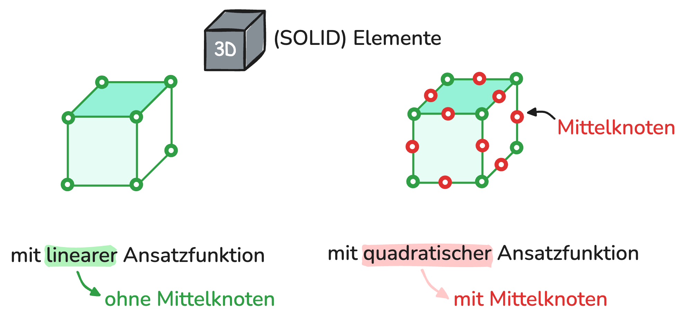
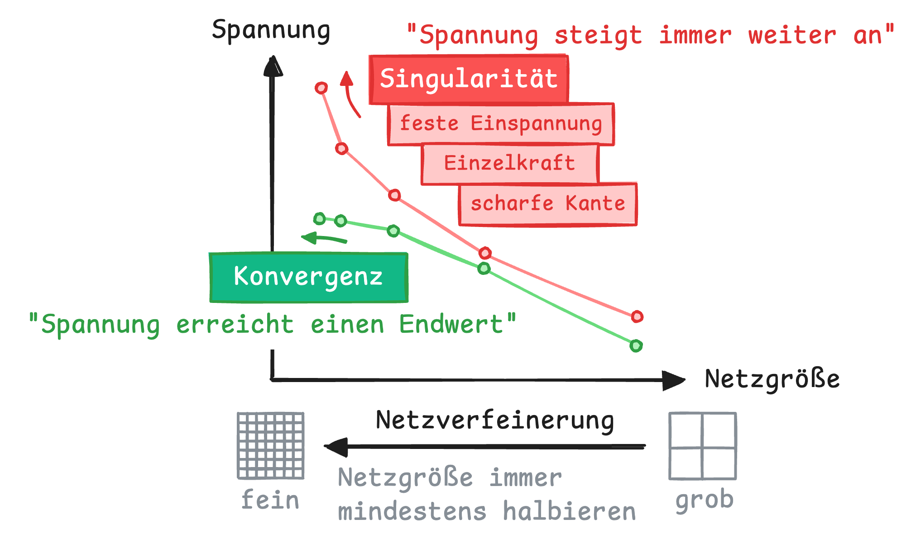
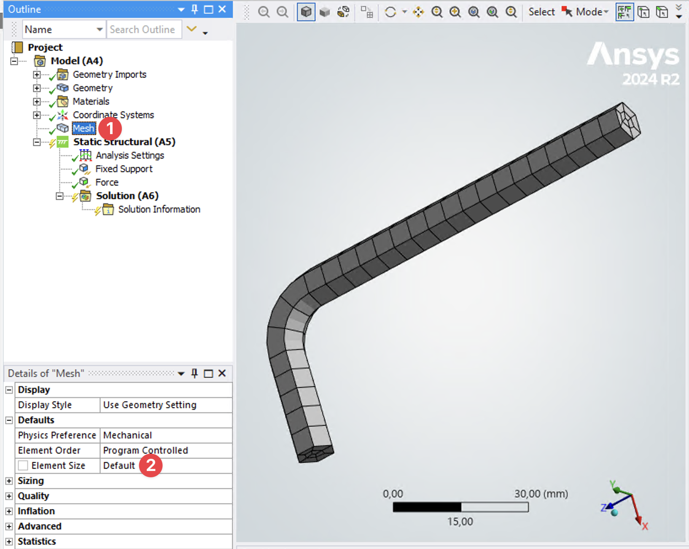
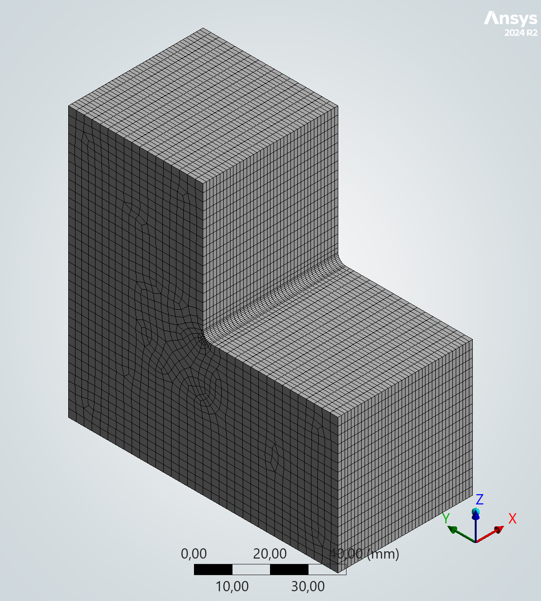
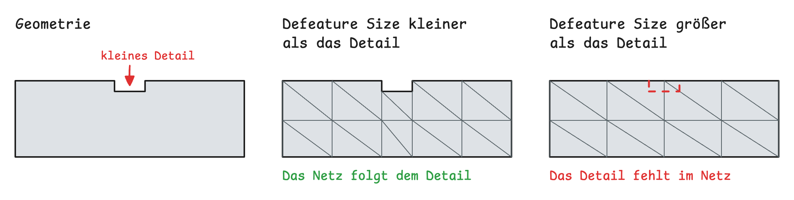
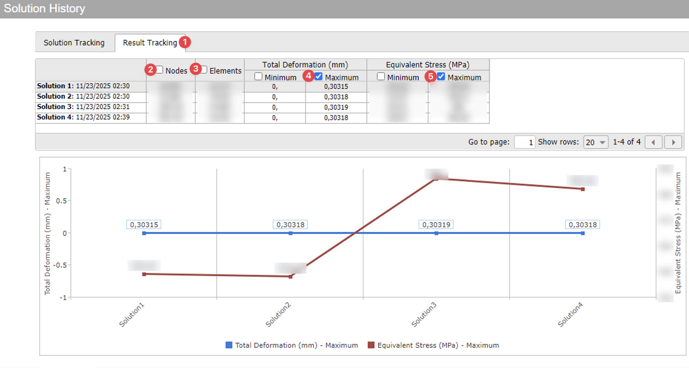
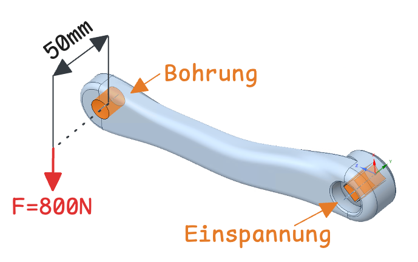
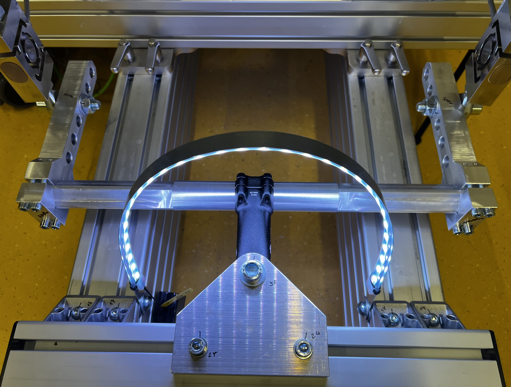
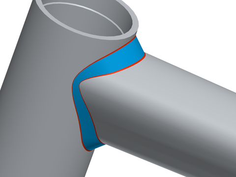
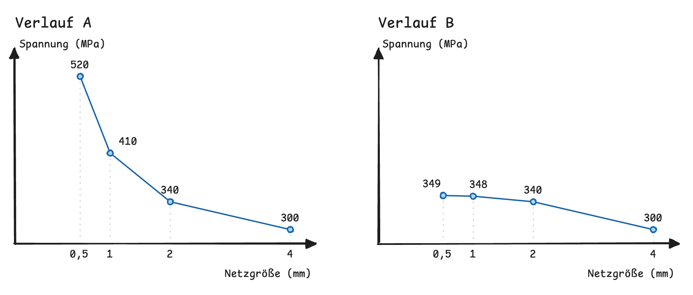

# :material-cube-unfolded: Vernetzung

!!! abstract "Lernziele"

    - [ ] Wie bestimme ich die richtige Netzgröße?
    - [ ] Wie gehe ich mit Singularitäten um? (Spannung steigt bei stetiger Netzverfeinerung ins Unendliche)

## Grundlagen

  <a class="prakt-card" href="01_Grundlagen/Elementtypen/">
    
    
      Elementtypen
    
  </a>
  <a class="prakt-card" href="01_Grundlagen/Sensitivitaetsanalyse/">
    
    
      Sensitivitätsanalyse
    
  </a>

## Umsetzung in ANSYS

  <a class="prakt-card" href="02_ANSYS_Umsetzung/Globale_Netzverfeinerung/">
    
    
      Globale Netzverfeinerung
    
  </a>
  <a class="prakt-card" href="02_ANSYS_Umsetzung/Lokale_Netzverfeinerung/">
    
    
      Lokale Netzverfeinerung
    
  </a>
  <a class="prakt-card" href="02_ANSYS_Umsetzung/Netzeinstellungen/">
    
    
      Netzeinstellungen und Konvergenz
      Method, Transition, Defeaturing, Inflation, Konvergenz
    
  </a>
  <a class="prakt-card" href="02_ANSYS_Umsetzung/Ergebnis_Tracking/">
    
    
      Ergebnis Tracking
    
  </a>
  <a class="prakt-card" href="02_ANSYS_Umsetzung/Uebung-3/">
    
    
      Übung 3
      Kurbelarm
    
  </a>
  <a class="prakt-card" href="02_ANSYS_Umsetzung/Uebung-4/">
    
    
      Übung 4
      Vorbau
    
  </a>
  <a class="prakt-card" href="02_ANSYS_Umsetzung/Uebung-5/">
    
    
      Übung 5
      Schweißnaht am Fahrradrahmen
    
  </a>
  <a class="prakt-card" href="02_ANSYS_Umsetzung/Quiz/">
    
    
      Quiz
      Welcher Schritt kommt als Nächstes?
    
  </a>

